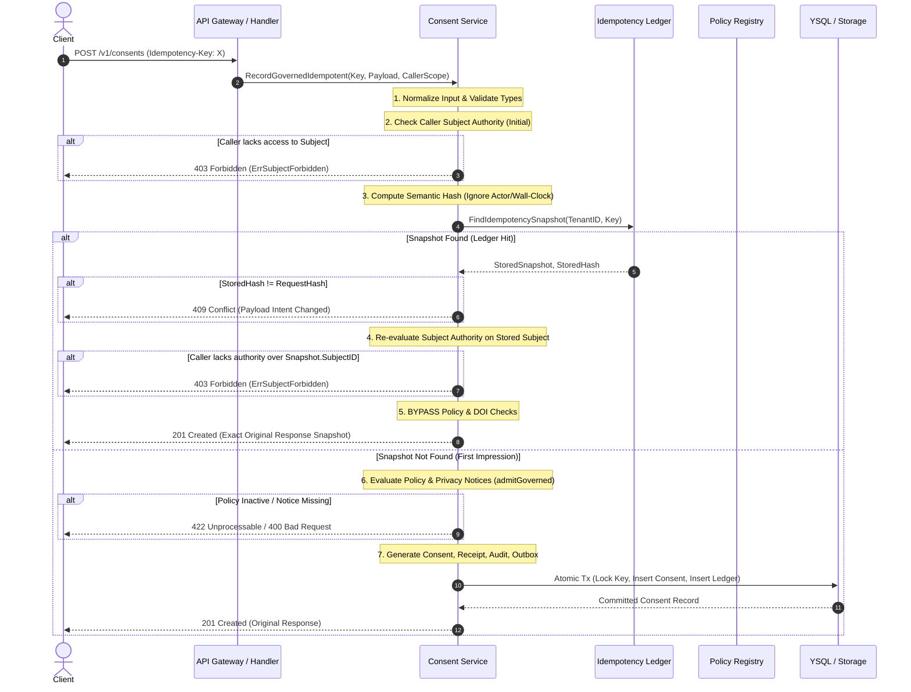

# Idempotency Replay Semantics and Key Retention Architecture

- **Document ID:** ARC-006
- **Version:** 1.0.0
- **Status:** APPROVED / NORMATIVE SPECIFICATION
- **Date:** 2026-10-21
- **Governing Tickets & Gates:** [T-025](file:///c:/antigravity/scratch/Nvuto-Consent/docs/production-readiness-audit/16_DETAILED_IMPLEMENTATION_BACKLOG.md#t-025), [F-025](file:///c:/antigravity/scratch/Nvuto-Consent/docs/production-readiness-audit/15_PRODUCTION_BLOCKERS_AND_RISK_REGISTER.md#f-025), [AT-025](file:///c:/antigravity/scratch/Nvuto-Consent/docs/production-readiness-audit/14_TESTING_QA_AND_VERIFICATION_REPORT.md#at-025), [G-025](file:///c:/antigravity/scratch/Nvuto-Consent/docs/production-readiness-audit/19_PRODUCTION_GO_LIVE_CHECKLIST.md#g-025)
- **Governing Decisions:** [D-11 (Idempotency Replay and Key Retention)](file:///c:/antigravity/scratch/Nvuto-Consent/docs/decisions/001_launch_scope_and_privacy.md), [D-04 (Policy Changes and Legacy Grants)](file:///c:/antigravity/scratch/Nvuto-Consent/docs/decisions/001_launch_scope_and_privacy.md)
- **Target Audience:** API consumers, backend/API engineers, platform integration teams (`INT-01` through `INT-08`), and site reliability engineers.

---

## 1. Executive Summary & Purpose

In a distributed, event-driven privacy management platform, network timeouts, client retries, and token rotations are standard operating occurrences. To guarantee safety and consistency across the consent lifecycle, the Nvuto-Consent API provides **governed idempotency** on preference creation endpoints via the HTTP `Idempotency-Key` header.

Prior to ticket [T-025](file:///c:/antigravity/scratch/Nvuto-Consent/docs/production-readiness-audit/16_DETAILED_IMPLEMENTATION_BACKLOG.md#t-025), idempotency replays were subject to live mutation drift:
1. Replays performed a live database lookup of the current consent record; if the consent had been withdrawn or modified, the replay returned the withdrawn state instead of the original 201 response.
2. Replays re-evaluated active policies and notices; if an administrator deactivated a purpose or updated a privacy notice, a legitimate client retry failed with a `422 Unprocessable Entity` or `400 Bad Request`.
3. Request fingerprinting included transient identity attributes (such as the specific OAuth bearer actor token) and raw wall-clock timestamps, causing legitimate retries across token rotation or clock skew to be rejected with `409 Conflict`.

This normative specification documents the corrected idempotency architecture: **exact response snapshotting**, **reordered validation with subject authorization re-evaluation**, **semantic payload fingerprinting**, and a **24-hour key retention lifecycle**.

---

## 2. Core Idempotency Contract

### 2.1 Exact Response Snapshotting (Historical vs. Live State)

When a consent record is successfully created (`POST /v1/consents` with an `Idempotency-Key` header), the service atomically records the resulting domain object into the `consent_idempotency` table under both `response_snapshot` and `original_response` (JSONB columns):

```sql
INSERT INTO consent_idempotency (
    tenant_id,
    idempotency_key,
    request_hash,
    consent_id,
    response_snapshot,
    original_response,
    created_at
) VALUES ($1, $2, $3, $4, $5, $5, $6);
```

When an identical request arrives matching an existing `(tenant_id, idempotency_key)`:
- The system returns the **exact original response snapshot** captured at creation time (`HTTP 201 Created`).
- The returned response contains the original `id`, `receipt_id`, `status` (e.g., `granted`), `created_at`, `evidence`, and metadata.
- The returned snapshot **never reflects subsequent state changes**, such as customer withdrawal, administrative expiration, or revocation.

> [!IMPORTANT]
> **Replay Endpoint Semantic:** Replaying `POST /v1/consents` with an `Idempotency-Key` is an **intent assertion retry**, NOT a status check. It confirms what occurred when the key was originally processed.

### 2.2 Critical Guidance for API Consumers: Checking Current Consent

Downstream consumers, frontend applications, and customer service portals **MUST NOT** replay `POST /v1/consents` to determine if a customer currently has valid consent.

To evaluate real-time consent:
- Call **`GET /v1/evaluate`** (or `POST /v1/evaluate` for batch checks) with `subject_id`, `purpose`, and `channel`.
- The evaluation engine checks current database state, expiration timestamps, double opt-in confirmation status, active suppressions, and active policy requirements.

| Operation | Target Endpoint | Behavior |
|---|---|---|
| **Initial Creation** | `POST /v1/consents` (with `Idempotency-Key`) | Admitted against current policy; records consent, receipt, audit log, outbox event, and snapshot. |
| **Network Retry / Replay** | `POST /v1/consents` (with `Idempotency-Key`) | Returns identical historical 201 response snapshot. Bypasses policy checks. |
| **Current Consent Evaluation** | `GET /v1/evaluate` | Evaluates live effective status (granted, denied, withdrawn, expired). |

---

## 3. Validation Order & Authorization Flow

To prevent policy changes from breaking legitimate replays while maintaining strict security boundaries, execution follows an explicit validation pipeline:



### 3.1 Subject Authorization Invariant (Security Rule)

Even when an idempotency key hits the ledger and live policy validation is bypassed:
- **Caller Subject Authority is strictly re-evaluated**: The current caller's JWT/principal scope must permit reading the target `subject_id` (`subScope.Permits(snapshot.SubjectID)`).
- A compromised or rotated token belonging to `cus-2` attempting to replay an idempotency key created by `cus-1` is immediately rejected with `403 Forbidden` (`ErrSubjectForbidden`).
- Tenant boundaries are inviolable: queries always include `tenant_id` as part of the primary lookup.

---

## 4. Semantic Fingerprinting & Conflict Detection

When a client uses an `Idempotency-Key`, the system verifies that the key is not being maliciously or accidentally reused for a different operation.

### 4.1 Canonical Semantic Hash Function

The system computes a canonical SHA-256 digest of the request payload using `ComputeSemanticHash`:

```go
type SemanticFingerprint struct {
    TenantID       string            `json:"tenant_id"`
    SubjectID      string            `json:"subject_id"`
    Purpose        string            `json:"purpose"`
    Channel        string            `json:"channel"`
    LegalBasis     string            `json:"legal_basis"`
    Status         domain.Status     `json:"status"`
    Source         string            `json:"source"`
    Scope          map[string]string `json:"scope,omitempty"`
    ExpiresAt      *string           `json:"expires_at,omitempty"`
    Jurisdiction   string            `json:"jurisdiction"`
    NoticeVersion  string            `json:"notice_version"`
    EvidenceMethod string            `json:"evidence_method,omitempty"`
    ArtifactHash   string            `json:"artifact_hash,omitempty"`
}
```

### 4.2 Deliberately Excluded Transient Fields

| Field | Exclusion Rationale |
|---|---|
| `actor_id` | Allows legitimate retries after token rotation or service account credential rollover. The security boundary is enforced via JWT subject scope, not caller actor ID matching. |
| `evidence.collected_at` | Prevents sub-millisecond clock drift, network serialization variances, or wall-clock differences on client retries from causing false conflicts. |
| Formatting / Whitespace | Field strings are trimmed and normalized before computing the digest. |

### 4.3 Conflict Handling (409 Conflict)

If an idempotency key exists in the ledger for the tenant, but the incoming `request_hash` differs from the stored hash:
- The server aborts the request immediately.
- Returns **`409 Conflict`** (`domain.ErrConflict` / `store.ErrConflict`).
- **No mutations** occur: no consent rows, receipts, audit logs, or outbox messages are emitted.

---

## 5. Concurrency and Atomicity

In high-throughput environments, multiple worker threads or client retries may submit identical requests simultaneously.

### 5.1 Durable Storage Invariants (PostgreSQL / YSQL)

`RecordGovernedIdempotent` executes within a single serializable/read-committed transaction:
1. `SELECT ... FROM consent_idempotency WHERE tenant_id=$1 AND idempotency_key=$2 FOR UPDATE`:
   - If the row exists, the winning transaction has already committed; the connection returns the stored snapshot without writing.
2. If the row does not exist, the transaction inserts:
   - `consents`
   - `consent_receipts`
   - `consent_audit_events`
   - `consent_outbox_events`
   - `consent_idempotency`
3. `INSERT INTO consent_idempotency ... ON CONFLICT (tenant_id, idempotency_key) DO UPDATE`:
   - Resolves concurrent race conditions where two threads pass the initial SELECT concurrently. Exactly one thread succeeds in inserting; the other receives the locked row, verifies hash equivalence, and returns the snapshot.
4. Total database writes for N concurrent identical requests: **exactly 1 consent, 1 receipt, 1 audit event, 1 outbox event, and 1 idempotency ledger row**.

---

## 6. Retention & Garbage Collection Architecture

### 6.1 Idempotency Key Retention Window (TTL)

- **Retention Window:** **24 Hours** (`INTERVAL '24 hours'`).
- **Rationale:** 24 hours provides sufficient headroom for client retry storms, network outages, and asynchronous consumer queue drains while bounding database table growth.
- Requests received after 24 hours with an expired key are treated as fresh requests.

### 6.2 Database Index for Pruning

Migration `010_idempotency_snapshots.sql` provides an index dedicated to efficient time-bounded pruning:

```sql
CREATE INDEX IF NOT EXISTS idx_consent_idempotency_retention
  ON consent_idempotency (created_at ASC);
```

### 6.3 Garbage Collection Execution Models

Two retention enforcement models are supported depending on deployment topology:

#### Option A: Scheduled Database Cleaner (PostgreSQL / YSQL)
A scheduled cron job or Kubernetes `CronJob` runs every hour:
```sql
DELETE FROM consent_idempotency
WHERE created_at < NOW() - INTERVAL '24 hours';
```
Because `created_at` is indexed, deletions execute as an index range scan in bounded batches (e.g., `LIMIT 5000`) without acquiring table-level locks.

#### Option B: Distributed KV Cache Tier (Redis / Memcached)
If an external KV store is placed in front of the persistence store for fast idempotency reservations:
- Keys are written with Redis command `SET key value EX 86400 NX`.
- Automatic TTL eviction guarantees key expiry at 24 hours without background sweeps.
- The PostgreSQL ledger remains the source of truth for durable verification.

---

## 7. Client Integration Summary & Anti-Patterns

### ❌ Anti-Pattern 1: Status Polling via Create Endpoint
```http
POST /v1/consents
Idempotency-Key: cus123_newsletter
```
*Issue:* If the customer previously granted consent but later withdrew it via the customer portal, replaying the creation call returns the original `201 Created` with `status: granted`. The client mistakenly assumes consent is active.

### ✅ Recommended Pattern: Evaluate Real-Time Status
```http
GET /v1/evaluate?subject_id=cus-123&purpose=newsletter&channel=email
```
*Result:* Returns `status: withdrawn`, `allowed: false`. Real-time enforcement is preserved.

### ❌ Anti-Pattern 2: Key Re-Use for Different Actions
Reusing `Idempotency-Key: order_1001` first with `status: granted` and later with `status: denied`.
*Result:* Returns `409 Conflict`. Clients must use distinct idempotency keys for distinct business actions (e.g., `order_1001_grant`, `order_1001_deny`).
