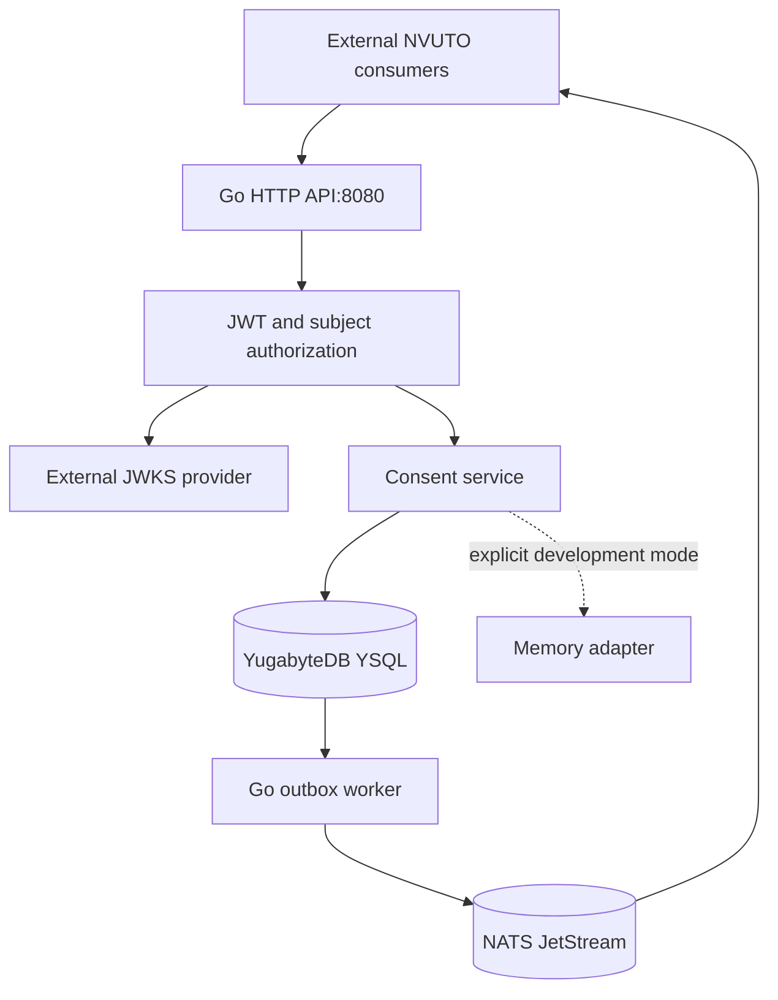

# 01 — Repository architecture map

**Product:** NVUTO Consent  
**Audit date:** 19 October 2026 (command timestamps in UTC; raw log offsets preserved)  
**Source:** supplied ZIP; commit and branch UNKNOWN  
**Disposition:** documentation-only audit; original source preserved.

## Repository identity and architecture classification

The supplied ZIP contains one Go module, `github.com/Atlasfsp/Nvuto-Consent`, with two deployable programs: the HTTP API and an outbox worker. It is a small shared service codebase with internal packages, not a supplied suite of eight independently implemented NVUTO products. The eight named products are consumers outside this archive. No frontend build system, static assets, mobile project, API gateway implementation or account system exists here.

The archive contains32 files, including19 Go files and10 test files. No `.git` directory, source commit, branch history or upstream PRD/TRD directory was supplied. A folder ending in `-main` is not proof of a branch or commit. The audit uses source-file SHA-256 checksums and the original ZIP digest as the exact handover baseline; see report21.

## Actual process and trust relationships

Solid connections describe source wiring or declared external interfaces, not verified live connections. JWT verification fetches configured JWKS over HTTP; it does not call Customer Graph to resolve identity. Consumers/IdP must provide the canonical `customer_subject_id` mapping. There is no API-side broker publish in the request transaction: the API commits SQL and returns before the worker publishes and before any consumer acknowledges. This distinction matters for propagation latency and fail-closed communication.

## Audited module inventory

| ID | Module | Source area | Responsibility |
| --- | --- | --- | --- |
| MOD-01 | HTTP API | cmd/server | Request decoding, routing, principal/role/subject checks, status codes and startup; one deployed API process. |
| MOD-02 | Authentication | internal/auth | JWT/JWKS verification and explicitly enabled development authentication; no account identity lifecycle. |
| MOD-03 | Shared domain | internal/domain | Consent, policy, notice, receipt, evidence, suppression, audit and event data contracts. |
| MOD-04 | Consent service | internal/service | Governed record/deny, withdrawal, evaluation, suppression, DOI, receipts, policy checks and idempotency fingerprinting. |
| MOD-05 | Persistence adapters | internal/store | Repository interface, YSQL via pgx, Memory development adapter, transactions and durable idempotency. |
| MOD-06 | Outbox publisher | cmd/outbox-worker | Second deployed process; SQL claim/publish/complete/retry loop and NATS JetStream envelope. |
| MOD-07 | Schema lifecycle | migrations | Three ordered SQL migrations, immutable evidence triggers and a short additive rollback note. |
| MOD-08 | Build, CI and deployment | .github/workflows/ci.yml; Dockerfile; Dockerfile.worker; deploy; scripts/ci | Two CI jobs, two container recipes, Kubernetes API/worker manifests and disposable RF1 YSQL bootstrap. |

Eight modules are the audit's explicit engineering groupings, not eight microservices. MOD-07 and MOD-08 are schema/delivery assets. MOD-03 through MOD-05 are shared packages used by the API; the worker accesses the durable outbox separately. The full repository interface has20 methods including Ping; production SQL implementations and the Memory adapter do not have identical behavior.

## Complete file map

| Repository-relative file | Lines | Bytes | Role |
| --- | --- | --- | --- |
| `.github/workflows/ci.yml` | 122 | 8653 | Go checks and RF1 YSQL/JetStream integration jobs |
| `Dockerfile` | 12 | 363 | API multi-stage image recipe |
| `Dockerfile.worker` | 11 | 386 | Worker multi-stage image recipe |
| `README.md` | 51 | 4145 | Only product/runtime prose baseline |
| `cmd/outbox-worker/main.go` | 234 | 7648 | Outbox claims, CloudEvent envelope, broker setup, publish/retry/complete loop |
| `cmd/outbox-worker/main_test.go` | 25 | 856 | Test source; external prerequisites indicated in report14 |
| `cmd/outbox-worker/postgres_integration_test.go` | 120 | 3141 | Test source; external prerequisites indicated in report14 |
| `cmd/server/idempotency_test.go` | 80 | 3157 | Test source; external prerequisites indicated in report14 |
| `cmd/server/main.go` | 457 | 13245 | HTTP models, handlers, routing, startup and shutdown |
| `cmd/server/main_test.go` | 138 | 5985 | Test source; external prerequisites indicated in report14 |
| `cmd/server/postgres_integration_test.go` | 83 | 3362 | Test source; external prerequisites indicated in report14 |
| `deploy/k8s.yaml` | 129 | 2973 | Namespace/API Deployment/Service/PDB/HPA desired state |
| `deploy/outbox-worker.yaml` | 83 | 2268 | Worker Deployment/PDB desired state |
| `go.mod` | 22 | 656 | Module path, Go version and direct/indirect dependency pins |
| `go.sum` | 40 | 3472 | Go module integrity checksums |
| `internal/auth/auth.go` | 200 | 5795 | JWT/JWKS verification and dev authentication gates |
| `internal/auth/auth_test.go` | 131 | 5058 | Test source; external prerequisites indicated in report14 |
| `internal/domain/model.go` | 151 | 5727 | Domain types, constants and JSON/event payload shapes |
| `internal/service/idempotency.go` | 82 | 4213 | Key validation, normalized semantic fingerprint and delegated creation |
| `internal/service/idempotency_test.go` | 44 | 2097 | Test source; external prerequisites indicated in report14 |
| `internal/service/policy_test.go` | 146 | 8082 | Test source; external prerequisites indicated in report14 |
| `internal/service/service.go` | 390 | 20049 | Policy, record/withdraw, DOI, suppression, receipt, evaluation logic |
| `internal/service/service_test.go` | 91 | 2792 | Test source; external prerequisites indicated in report14 |
| `internal/store/idempotency.go` | 99 | 3349 | Memory and SQL idempotency ledger implementations |
| `internal/store/idempotency_integration_test.go` | 73 | 2835 | Test source; external prerequisites indicated in report14 |
| `internal/store/memory.go` | 340 | 10886 | Repository interface and development Memory implementation |
| `internal/store/postgres.go` | 396 | 19399 | pgx YSQL pool, queries, atomic governed writes and evidence/event inserts |
| `migrations/001_init.sql` | 45 | 1655 | Base consents/audit/outbox schema |
| `migrations/002_policy_governance.sql` | 110 | 4174 | Governance/receipt/suppression tables, consent extensions, immutable triggers |
| `migrations/003_governed_idempotency.sql` | 11 | 355 | Durable governed-create idempotency ledger |
| `migrations/ROLLBACK.md` | 5 | 889 | Additive002 rollback note; limited and unverified |
| `scripts/ci/start-yugabytedb.sh` | 37 | 1576 | Disposable Docker RF1 YSQL startup and topology check |

## API process

`cmd/server/main.go:413-457` selects YSQL when DATABASE_URL exists, otherwise requires explicit ALLOW_MEMORY_STORE=true, then binds port8080. It installs a5-second header timeout,15-second read/write timeouts,60-second idle timeout and15-second shutdown budget. The repository interface does not accept request contexts, so these HTTP settings do not cancel its context.Background database work (F-012). The YSQL adapter pool has max25/min2 connections; default API3 replicas and HPA max20 imply up to500 API connections before worker/admin traffic, a capacity calculation rather than a tested operating limit.

All11 business operations are registered in `cmd/server/main.go:399-409`. Seven roles are recognized by explicit arrays and `subjectAuthorized`; no dynamic database policy engine controls endpoint roles. OPS-01 `/healthz` always returns200 and OPS-02 `/readyz` checks storage ping only. The complete routes, fields, response statuses and side effects are in report06.

## Durable state and change propagation

The production engine is **YugabyteDB YSQL** (`README.md:45,51`). The `Postgres` type, PostgreSQL URI and startup log wording reflect the compatible driver and do not authorize substituting ordinary PostgreSQL for production validation. The schema has nine tables: consents, audit events, outbox events, purposes, lawful bases, privacy notices, receipts, suppressions and idempotency. SQL transitions generally maintain atomic state/audit/outbox, with receipts on governed record and confirmation.

The worker claims batches of50 using row locking/SKIP LOCKED, assigns a120-second lease, publishes serially to JetStream and marks complete or schedules exponential retry up to900 seconds. It uses CloudEvents1.0, event schema version1 and Nats-Msg-Id deduplication. Eight event families expand to nine concrete types because captured granted and denied decisions have separate event names. The ten-minute configured broker dedup window is finite; it cannot alone guarantee exactly-once business effects. Completion/retry do not check current lease ownership (F-009); events lack a monotonic preference revision (F-010).

The worker creates a stream if missing, with a three-replica baseline, but accepts an existing stream without checking settings (F-020). API3/worker2 replica manifests do not prove the actual DB or broker topology. There is no cron scheduler, expiration sweep, consumer implementation or trusted DOI delivery adapter in this repository.

## Production vs development/legacy paths

- **Production path:** HTTP governed service operations → tenant-parameterized YSQL transactions → outbox → worker → JetStream. JWT/JWKS is the expected authentication path.
- **Development path:** explicitly enabled Memory storage and HMAC/header auth. Unit/handler tests use these controls. The Memory tenant-key collision and contract differences must not be attributed to the SQL adapter.
- **Legacy internal path:** `Service.Record` and `Repository.Upsert` remain for old tests/compatibility; the active consent POST uses governed creation. `Record` can ignore separate audit/outbox errors, a latent reuse risk rather than an active public bypass (F-031).
- **Unseen external path:** actual frontend, Customer Graph mapping, delivery, consumer state and production infrastructure. Their implementations cannot be reconstructed from a consumer name or ConfigMap reference.

## Build and operations assets

`go.mod` pins Go1.25.13, jwt/v5 v5.2.2, pgx/v5 v5.9.2 and nats.go v1.47.0, with10 listed indirect requirements. Both Dockerfiles use a Go Alpine build stage and distroless Debian12 nonroot runtime. The current vulnerability gate requires patching and rescanning; source build success does not settle dependency security.

The workflow has two jobs: general Go/container checks and a real RF1 YSQL functional job that also starts a single-node NATS fixture. The latter omits the store idempotency integration test and upgrades legacy fixtures only through002. The manifests use mutable image tags and reference unsupplied configuration/secrets. Database/NATS provisioning, registry publishing, ingress/TLS, network isolation, monitoring and restore ownership remain external dependencies documented in reports11,12 and20.

## Architecture decisions requiring completion

The most consequential design work is one preference-level revision/time/policy model shared by direct decisions, DOI, suppression and events. Separate local fixes based only on timestamps would leave cross-path races. Canonical evidence/versioning and target-YSQL migration design must be agreed before legacy backfill. Decide the authoritative read owner for self-service/admin consumers and the trusted delivery owner for DOI. Details are D-01 through D-14; tickets T-001 through T-032 preserve the exact dependency order.
