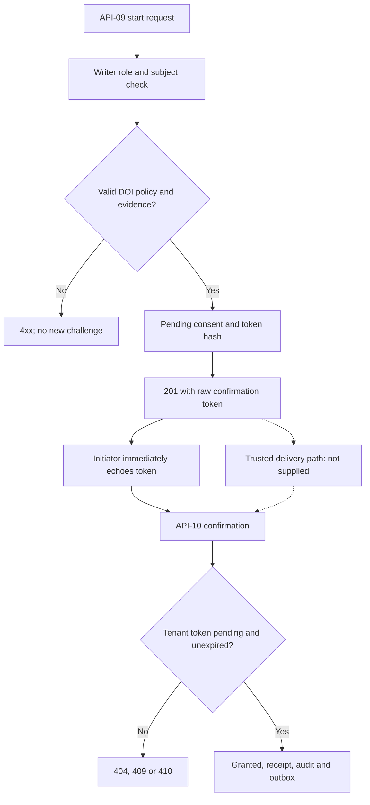
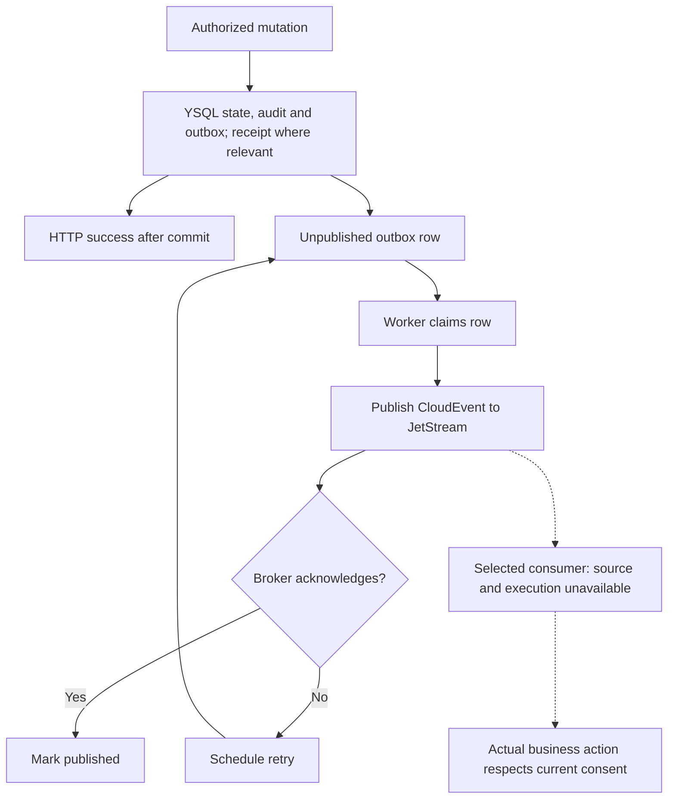

# 09 — Application and user-flow audit

**Audit date:** 19 October 2026. **Scope:** eleven service-facing workflows reconstructed from the README and actual handlers, services, storage and worker. There are no user-interface screens in the supplied archive, so external account, browser and consumer steps are explicitly unverified. This report does not introduce a standalone frontend, signup system or campaign executor into Consent’s scope.

The stated functional sequence is capture evidence, evaluate a purpose/channel decision, enforce effective/withdrawn state, expose self-service changes, propagate changes and retain immutable history (`README.md:11`). The eight consuming applications are names in `README.md:9`; their source and runtime evidence were not supplied. [D-01](20_OPEN_DECISIONS_AND_EXTERNAL_DEPENDENCIES.md#d-01) and [D-07](20_OPEN_DECISIONS_AND_EXTERNAL_DEPENDENCIES.md#d-07) define the release boundary and selected consumers. [Report07](07_FRONTEND_BACKEND_INTEGRATION_MATRIX.md) contains the corresponding execution and consumer matrix; [report06](06_BACKEND_AND_API_AUDIT.md) contains the exact API contracts.

## Reading the flow states

**PRESENT** means source wiring exists. **PARTIAL** means some required behavior exists but a documented gap remains. **BROKEN** identifies a confirmed counterexample or source defect, with its reproduction limit. **NOT VERIFIED** means the relevant environment, consumer or execution evidence is unavailable. **DECISION REQUIRED** identifies an undocumented intended rule. No complete user journey is declared production-verified on the strength of memory tests.

The unchanged suite produced **15 PASS / 3 SKIP**, also under race detection. Separate audit probes produced **11 FAIL + 1 OBSERVATION** in a disposable copy. The tests were synthetic and non-destructive; they did not send external confirmation messages or execute against a live YSQL universe. One receipt test used the real pgx timestamp codec without a database. Exact results are in [14_TESTING_QA_AND_VERIFICATION_REPORT.md](14_TESTING_QA_AND_VERIFICATION_REPORT.md).

| Workflow | Name | Primary persona |
|---|---|---|
| WF-01 | Authenticate and map subject | Customer, operator or service |
| WF-02 | Maintain purpose/basis/notice | Privacy/consent administrator |
| WF-03 | Capture or deny preference | Customer or authorized collecting application |
| WF-04 | Load and edit existing preferences | Customer or administrator through an owning app |
| WF-05 | Withdraw consent | Customer or authorized operator/application |
| WF-06 | DOI collection and confirmation | Customer plus trusted delivery owner |
| WF-07 | Set/clear layered suppression | Customer, writer or administrator |
| WF-08 | Authorize one outbound action | Decision-consuming application |
| WF-09 | Batch authorization | Decision-consuming application |
| WF-10 | Retrieve evidence and investigate history | Customer or authorized privacy reviewer |
| WF-11 | Publish and consume a change | Outbox worker and selected consumer |

## WF-01

**Authenticate and map subject**

**Goal and entry.** An external user or application presents a trustworthy tenant/actor/role identity and, for self-service, the canonical Customer Graph subject. Login, signup, password recovery, verification, profile setup and logout are owned externally: this service expressly excludes customer identity (`README.md:7,41`). There is no frontend route or identity lifecycle endpoint to audit here.

**Current successful path.** The client obtains a token through an external, unverified issuer/session flow. It calls one of API-01–API-11 with Bearer authorization. The handler first checks the HTTP method, then invokes `auth.FromRequest`, which uses production RS256/JWKS with configured issuer/audience and required expiration. `tenant_id` becomes the tenant, registered `sub` the actor, `customer_subject_id` the canonical customer, and roles remain exact strings. The handler applies its admitted role set and, where implemented, its subject check. Sources: `internal/auth/auth.go:27-31,131-188`; `cmd/server/main.go:88-118`.

**Failure, cancellation and lifecycle paths.** Missing/invalid authentication returns 401; an authenticated role outside the handler’s set returns 403. A solely self-service principal requesting another subject receives 403 wherever `subjectAuthorized` runs. API-10 omits that check and is broken under [F-002](15_PRODUCTION_BLOCKERS_AND_RISK_REGISTER.md#f-002). A missing canonical customer claim is not globally rejected by auth; most subject checks reject it later. Mixed roles can combine self_service write admission with another role's tenant-wide subject bypass; self_service plus service/consent_reader can consequently perform tenant-wide subject writes, as detailed in F-030 and report04. Expiry, refresh, revocation, account deactivation and canonical-party merges require a defined external lifecycle contract; no claim is made that this service coordinates them. Abandoning an authentication request causes no business mutation, but cancellation of later database work is incomplete under [F-012](15_PRODUCTION_BLOCKERS_AND_RISK_REGISTER.md#f-012).

**Evidence and completion.** Synthetic JWKS and selected HMAC cases PASS; the existing own/other-subject handler test covers evaluation only (`internal/auth/auth_test.go:26-131`; `cmd/server/main_test.go:105-138`). Five local unknown-key misses caused five JWKS fetches in a failing probe, [F-014](15_PRODUCTION_BLOCKERS_AND_RISK_REGISTER.md#f-014). No actual Authentik mapper or selected consumer token propagation was exercised. Approve [D-06](20_OPEN_DECISIONS_AND_EXTERNAL_DEPENDENCIES.md#d-06)/[D-10](20_OPEN_DECISIONS_AND_EXTERNAL_DEPENDENCIES.md#d-10), enforce the full matrix through [T-002](16_DETAILED_IMPLEMENTATION_BACKLOG.md#t-002)/[T-030](16_DETAILED_IMPLEMENTATION_BACKLOG.md#t-030), and supply real provider/consumer evidence through [T-023](16_DETAILED_IMPLEMENTATION_BACKLOG.md#t-023). **Status: PRESENT authentication; PARTIAL authorization; external lifecycle NOT VERIFIED.**

**Traceability:** RQ-012–RQ-014, RQ-018; F-002/F-014/[F-015](15_PRODUCTION_BLOCKERS_AND_RISK_REGISTER.md#f-015)/[F-023](15_PRODUCTION_BLOCKERS_AND_RISK_REGISTER.md#f-023)/[F-030](15_PRODUCTION_BLOCKERS_AND_RISK_REGISTER.md#f-030); [AT-002](14_TESTING_QA_AND_VERIFICATION_REPORT.md#at-002)/[AT-014](14_TESTING_QA_AND_VERIFICATION_REPORT.md#at-014)/[AT-015](14_TESTING_QA_AND_VERIFICATION_REPORT.md#at-015)/[AT-023](14_TESTING_QA_AND_VERIFICATION_REPORT.md#at-023)/[AT-030](14_TESTING_QA_AND_VERIFICATION_REPORT.md#at-030); [G-002](19_PRODUCTION_GO_LIVE_CHECKLIST.md#g-002)/[G-030](19_PRODUCTION_GO_LIVE_CHECKLIST.md#g-030). The exact permission matrix is [report04](04_USER_PERSONAS_ROLES_AND_PERMISSIONS.md).

## WF-02

**Maintain purpose/basis/notice**

**Goal and entry.** A privacy/consent administrator defines the purpose/channel policy, valid lawful basis and notice metadata needed before governed capture. Accepted current roles are privacy_admin, consent_admin and developer. There is no administrator screen, registry list or version-aware editor in this archive. Source: `cmd/server/main.go:109,120-178`.

**Current successful path.** API-01 POST `/v1/purposes` normalizes code/category/channels and upserts the tenant-purpose row. API-02 POST `/v1/lawful-bases` normalizes code/categories and upserts the tenant-basis row. Both return 201 with version/update time and emit audit/outbox records in the production transaction. API-03 POST `/v1/notices` inserts a tenant+jurisdiction+version notice whose publication time is not future; duplicate versions conflict. No cross-entity transaction groups the three calls, but they do not need to be executed in a fixed order until the caller attempts a governed capture. Sources: `internal/service/service.go:49-105`; `internal/store/postgres.go:146-236`.

**Failure/cancellation and edges.** Each successful POST commits independently: cancelling a setup wizard after one call would leave that registry change persisted. That hypothetical UI must be designed by its actual owner. Invalid fields return 422; a repeated notice insert returns 409 even for an identical body. Active and requirement booleans omitted from JSON become false; full-state registry upserts can overwrite prior flags. Returned versions are not optimistic-concurrency preconditions. There is no registry GET/list, PATCH, approval step, policy snapshot query or notice retirement endpoint. Immutable notices have Active as create-time metadata, while future publication is rejected; draft/scheduled/retirement behavior is undecided. Source: `cmd/server/main.go:128-177`; `internal/service/service.go:49-85`.

**Evidence and completion.** Basic HTTP registry creates PASS, but two isolated probes found incompatible older grants remain allowed after affirmative/DOI requirements are strengthened. No explicit grandfathering rule exists. Evidence content and reconstructable historical policy also remain incomplete. [T-005](16_DETAILED_IMPLEMENTATION_BACKLOG.md#t-005)/[T-007](16_DETAILED_IMPLEMENTATION_BACKLOG.md#t-007)/[T-024](16_DETAILED_IMPLEMENTATION_BACKLOG.md#t-024)/[T-027](16_DETAILED_IMPLEMENTATION_BACKLOG.md#t-027)/[T-029](16_DETAILED_IMPLEMENTATION_BACKLOG.md#t-029) must define content, policy transitions, reads/edit semantics and audit history before the administrator workflow is treated as complete. Real operator screens and reload behavior belong to selected consumer T-023. **Status: PRESENT write path; PARTIAL governance and admin workflow.**

**Traceability:** RQ-002–RQ-004, RQ-019; [F-005](15_PRODUCTION_BLOCKERS_AND_RISK_REGISTER.md#f-005)/[F-007](15_PRODUCTION_BLOCKERS_AND_RISK_REGISTER.md#f-007)/[F-024](15_PRODUCTION_BLOCKERS_AND_RISK_REGISTER.md#f-024)/[F-027](15_PRODUCTION_BLOCKERS_AND_RISK_REGISTER.md#f-027)/[F-029](15_PRODUCTION_BLOCKERS_AND_RISK_REGISTER.md#f-029); [AT-005](14_TESTING_QA_AND_VERIFICATION_REPORT.md#at-005)/[AT-007](14_TESTING_QA_AND_VERIFICATION_REPORT.md#at-007)/[AT-024](14_TESTING_QA_AND_VERIFICATION_REPORT.md#at-024)/[AT-027](14_TESTING_QA_AND_VERIFICATION_REPORT.md#at-027)/[AT-029](14_TESTING_QA_AND_VERIFICATION_REPORT.md#at-029); [D-04](20_OPEN_DECISIONS_AND_EXTERNAL_DEPENDENCIES.md#d-04)/[D-05](20_OPEN_DECISIONS_AND_EXTERNAL_DEPENDENCIES.md#d-05)/D-06/D-07. See [G-005](19_PRODUCTION_GO_LIVE_CHECKLIST.md#g-005)/[G-007](19_PRODUCTION_GO_LIVE_CHECKLIST.md#g-007)/[G-029](19_PRODUCTION_GO_LIVE_CHECKLIST.md#g-029).

## WF-03

**Capture or deny preference**

**Goal and entry.** An external form/application records a customer’s granted or denied choice with the approved policy/notice/evidence. The caller needs a writer role; a solely self_service caller must target its own canonical subject. Approved evidence artifacts, user-facing notice text and collection UI are external and not supplied. Source: `README.md:11,15-18`; `cmd/server/main.go:180-203`.

**Current successful path.** The client POSTs API-04 `/v1/consents` with subject, purpose, channel, legal_basis, status, source, jurisdiction, notice_version and evidence, plus optional scope/consent expiry. The handler rejects unknown JSON fields, authenticates and authorizes the subject. The service normalizes identifiers, requires status granted or denied, looks up active compatible purpose/basis/notice and validates evidence when required. A direct grant for a DOI purpose is rejected; affirmative grants require the literal consent basis. It creates a new consent ID, receipt/hash, audit and outbox event; production stores them atomically. The response is201 with consent/receipt IDs and no evidence/token hash in the Consent JSON. Sources: `internal/service/service.go:88-150`; `internal/store/postgres.go:238-259`.

**Retry, cancellation and failure paths.** An optional trimmed Idempotency-Key of at most200 bytes routes to the ledger; no key means every successful call creates another record. Exact immediate replay returns the original resource ID; changed fingerprint409. The actor is part of the fingerprint, live policy is checked before ledger lookup and the current resource is returned on replay. A retry after withdrawal can return 201 with withdrawn status; it is not evidence of present permission. Cancelling after a committed response does not reverse the record; the client must use a deliberate subsequent denial/withdrawal. A lost response can leave committed state even when the caller did not see201. Generic store/runtime failures currently become422, and request cancellation does not bound all SQL work. F-012/[F-013](15_PRODUCTION_BLOCKERS_AND_RISK_REGISTER.md#f-013)/[F-025](15_PRODUCTION_BLOCKERS_AND_RISK_REGISTER.md#f-025) cover these distinctions.

**Negative-preference edges.** Denied capture uses the same active-policy/evidence requirements as grant, so an unavailable or retired policy can prevent recording that path. Withdrawal by known ID is a separate flow. Consent expiry can precede creation; arbitrary evidence hash strings pass nonempty checks. Scope is stored metadata and not evaluated as a decision dimension. T-027 with D-05/[D-12](20_OPEN_DECISIONS_AND_EXTERNAL_DEPENDENCIES.md#d-12) must define the intended validation and opt-out behavior without silently authorizing consent.

**Evidence and completion.** Memory-backed governed capture and immediate key replay tests PASS. Receipt hash presence is tested, but the codec probe demonstrated stored timestamp precision can invalidate the hash; notice/full decision binding is also missing. No real browser/YSQL/evidence-storage journey was executed. **Status: PARTIAL.**

**Traceability:** RQ-005/RQ-006/RQ-015/RQ-018; [F-004](15_PRODUCTION_BLOCKERS_AND_RISK_REGISTER.md#f-004)/F-005/F-012/F-013/[F-016](15_PRODUCTION_BLOCKERS_AND_RISK_REGISTER.md#f-016)/F-025/F-027; [AT-004](14_TESTING_QA_AND_VERIFICATION_REPORT.md#at-004)/AT-005/[AT-016](14_TESTING_QA_AND_VERIFICATION_REPORT.md#at-016)/[AT-025](14_TESTING_QA_AND_VERIFICATION_REPORT.md#at-025)/AT-027; [G-004](19_PRODUCTION_GO_LIVE_CHECKLIST.md#g-004)/G-005/[G-016](19_PRODUCTION_GO_LIVE_CHECKLIST.md#g-016); D-05/[D-11](20_OPEN_DECISIONS_AND_EXTERNAL_DEPENDENCIES.md#d-11)/D-12. Full input schema: [report06](06_BACKEND_AND_API_AUDIT.md).

## WF-04

**Load and edit existing preferences**

**Goal and entry.** A customer or administrator opens an owning application and needs accurate current preferences, purposes/channels and relevant notice information before changing anything. This is a required integration design question arising from the documented self-service capability, not proof that Consent must ship a standalone screen. D-01/D-07 determine ownership and launch scope.

**Current trace.** No subject preference collection, consent-by-ID GET, registry list or suppression list is registered. A client that already knows subject/purpose/channel pairs can call API-07 or API-08 to obtain decisions. A known receipt ID can be read through API-11. Those APIs do not provide a complete initial preference model, all policy vocabulary or all suppressions. `Service.Consent` is used internally by withdrawal; it is not an exposed GET endpoint. Sources: `cmd/server/main.go:224,386-410`; `internal/service/service.go:328-340`; `internal/domain/model.go:41-47,120-125`.

**Incomplete success path.** An external projection might already own initialization, but no source or contract for it was supplied. A success path cannot therefore be described as verified. T-024 must choose between authorized Consent read APIs and an approved externally owned projection, with clear current-state/version, bounded pagination/filtering where needed and reconciliation. Once a state source exists, the customer can submit selected changes through WF-03/WF-05/WF-07, but the actual frontend feedback, cache invalidation and reload are absent.

**Failure/cancellation and edges.** Do not display “no consent” just because a collection route is absent or a read fails. Evaluate’s no_consent is a specific business result for a requested pair. A suppression decision omits the underlying consent ID, so an interface cannot assume every disallowed result supplies an ID to withdraw. Batch results are positional and lack input IDs. If policy changes after a screen loads, direct mutations may fail or overwrite fields; approved version/concurrency behavior must be specified. Cancelling an edit before POST should leave server state unchanged in the owning UI, but that behavior has not been tested. Reopening/reloading after a committed change must read durable current state rather than local optimistic state alone.

**Evidence and completion.** The absence of these API routes is confirmed; the presence or correctness of another product’s projection is UNKNOWN. T-024/T-023 must prove initial load, change, reload, cross-subject/tenant rejection and reconciliation after consumer restart. **Status: DECISION REQUIRED / INTEGRATION INCOMPLETE, not an asserted missing approved frontend.**

**Traceability:** RQ-001/RQ-018/RQ-021; F-023/F-024/[F-032](15_PRODUCTION_BLOCKERS_AND_RISK_REGISTER.md#f-032); AT-023/AT-024/[AT-032](14_TESTING_QA_AND_VERIFICATION_REPORT.md#at-032); [G-023](19_PRODUCTION_GO_LIVE_CHECKLIST.md#g-023)/[G-024](19_PRODUCTION_GO_LIVE_CHECKLIST.md#g-024); D-01/D-07. See [the frontend audit](05_FRONTEND_AUDIT.md).

## WF-05

**Withdraw consent**

**Goal and entry.** A customer or authorized writer revokes a known consent, and subsequent decision/consumer behavior must honor the withdrawal. The caller needs a writer role; the handler first retrieves the consent within tenant and checks its stored subject for a self-service caller. Source: `cmd/server/main.go:211-234`.

**Current successful path.** API-05 POST `/v1/consents/{id}/withdraw` requires no decoded body. The service loads the consent. If already withdrawn it returns that state without new effects. Otherwise it sets withdrawn status/time, increments the version and asks the repository to perform a transaction. The production repository locks the current row, rechecks already-withdrawn state, updates and appends audit/outbox, returning200. Sources: `internal/service/service.go:181-199`; `internal/store/postgres.go:261-286`.

**Failure/cancellation and edges.** An absent or other-tenant ID yields 404; an existing other-subject record yields 403 for solely self-service. Any non-withdrawn status, including denied or pending, can enter withdrawal; no status-specific approval workflow exists. A repeated request is naturally repeat-safe per record. If the response is lost, the client can retry the same ID. A cancelled request does not prove a transaction was cancelled, F-012. There is no undo endpoint; a later new affirmative preference would use the approved capture/DOI flow. The system must not confuse that new intent with an old confirmation capability.

**Confirmed blocker.** An earlier pending challenge remains usable after a newer grant is withdrawn; confirming it makes its older consent row newest and Evaluate allowed=true. The audit reproduced this with memory storage and traced the equivalent durable logic. This is [F-001](15_PRODUCTION_BLOCKERS_AND_RISK_REGISTER.md#f-001)/P0, not merely missing external evidence. Another probe observed that withdrawing an older row after a newer grant makes the older withdrawn row effective; whether withdrawal means revoke this record or the current preference requires [D-03](20_OPEN_DECISIONS_AND_EXTERNAL_DEPENDENCIES.md#d-03)/[F-006](15_PRODUCTION_BLOCKERS_AND_RISK_REGISTER.md#f-006).

| Observed stale-challenge sequence | Current state consequence |
|---|---|
| Create pending challenge A; later create/confirm B | B is the newer granted consent. |
| Withdraw B | B becomes withdrawn; current evaluation disallows it. |
| Confirm still-valid A | A becomes newest by UpdatedAt and evaluation allows communication again. |

**Completion.** [T-001](16_DETAILED_IMPLEMENTATION_BACKLOG.md#t-001) must bind challenges and changes to a transactionally controlled preference generation; [T-006](16_DETAILED_IMPLEMENTATION_BACKLOG.md#t-006) must define record/current-state semantics. [AT-001](14_TESTING_QA_AND_VERIFICATION_REPORT.md#at-001) must pass on memory and real YSQL. T-023 must then show actual selected consumers prevent the affected action within an approved propagation interval. **Status: per-record mutation PRESENT; withdrawal safety invariant BROKEN; consumer outcome NOT VERIFIED.**

**Traceability:** RQ-007/RQ-008/RQ-018; F-001/F-006/[F-010](15_PRODUCTION_BLOCKERS_AND_RISK_REGISTER.md#f-010)/F-012/F-023; AT-001/[AT-006](14_TESTING_QA_AND_VERIFICATION_REPORT.md#at-006)/[AT-010](14_TESTING_QA_AND_VERIFICATION_REPORT.md#at-010)/AT-023; [G-001](19_PRODUCTION_GO_LIVE_CHECKLIST.md#g-001)/[G-006](19_PRODUCTION_GO_LIVE_CHECKLIST.md#g-006)/G-023; D-03/[D-08](20_OPEN_DECISIONS_AND_EXTERNAL_DEPENDENCIES.md#d-08)/[D-13](20_OPEN_DECISIONS_AND_EXTERNAL_DEPENDENCIES.md#d-13).

## WF-06

**DOI collection and confirmation**

**Goal and entry.** The purpose requires double opt-in. The intended customer needs to confirm through an approved independent channel before permission is granted. Current routes admit writer roles including self_service. A trusted external delivery owner and verified destination contract are not implemented; [D-02](20_OPEN_DECISIONS_AND_EXTERNAL_DEPENDENCIES.md#d-02) must define them.

**Current successful path.** API-09 accepts subject, purpose, channel, source, jurisdiction, notice version, evidence and a future expires_at. It uses the consent basis and verifies the purpose requires DOI. It generates 32 random bytes encoded as64 hex characters, stores the SHA-256 token hash in a new pending consent and writes audit/outbox. The challenge response is201 with the raw confirmation_token. API-10 accepts token, finds it in the tenant, verifies pending/expiry, and the repository locks and rechecks the token row before granting, clearing the hash and adding receipt/audit/outbox. The response is200 granted. Sources: `cmd/server/main.go:319-362`; `internal/service/service.go:256-325`; `internal/store/postgres.go:340-383`.

The solid immediate-echo path was reproduced. The dotted delivery step is an absent dependency, not an implemented or tested route. The current confirmation handler does not check canonical subject before the final token-state branch.

**Three separate defects.** F-001: an older challenge can supersede a later denial/withdrawal. F-002: same-tenant customer B can confirm A’s valid token and receive A’s record. [F-003](15_PRODUCTION_BLOCKERS_AND_RISK_REGISTER.md#f-003): the initiator receives the capability needed to confirm and can directly echo it without independent delivery. Strong randomness does not repair either authorization or the delivery-proof boundary. The audit did not guess tokens or establish cross-tenant confirmation.

**Failure/cancellation and edges.** Wrong/used token generally returns 404; expired pending token410; locked-state conflicts can return 409. A sequential successful replay is not idempotent200 because the hash is cleared. Start has no Idempotency-Key, maximum lifetime, resend-specific API, destination address, delivery status or dedicated cancellation endpoint. Its expires_at is the challenge expiry, not the granted consent expiry. Restarting collection can create multiple pending records. Withdrawing a pending consent is possible through API-05, but that is not a complete cross-challenge cancellation policy. If trusted delivery fails after creation, the current code has no provider-specific recovery orchestration. Confirmation also does not rerun all policy checks after a policy change, F-007.

**Completion.** T-001/T-002 must protect current intent and subject under the atomic transaction; [T-003](16_DETAILED_IMPLEMENTATION_BACKLOG.md#t-003) must keep the secret in an approved trusted delivery path and expose only public challenge state to an untrusted initiator. Define generation/destination/notice binding, resend, cancellation, timeout, expiry, partial delivery failure and bounded abuse handling. Own-subject approval, wrong subject, cross tenant, replay, old challenge, policy change and actual controlled delivery must pass AT-001/AT-002/[AT-003](14_TESTING_QA_AND_VERIFICATION_REPORT.md#at-003)/AT-007/AT-016. **Status: BROKEN.**

**Traceability:** RQ-005/RQ-011/RQ-013; F-001/F-002/F-003/F-007/F-016; G-001/G-002/[G-003](19_PRODUCTION_GO_LIVE_CHECKLIST.md#g-003)/G-016; D-02/D-03/D-06/D-07/D-10.

## WF-07

**Set/clear layered suppression**

**Goal and entry.** A subject or authorized operator suppresses an entire subject, a channel or a purpose/channel combination. Current writer roles can set or clear these records, with own-subject restriction for solely self_service. Whether a customer may clear a block originally created by an administrator is unresolved under D-06/F-030.

**Current successful path.** API-06 POST `/v1/suppressions` accepts subject, exact scope, reason, active and relevant channel/purpose. Global requires both dimensions blank; channel requires channel and blank purpose; purpose_channel requires both. The service normalizes values and generates an ID; the production upsert uses tenant+subject+scope+purpose+channel as natural key, preserving the prior ID and increasing version on an update. It writes audit/outbox and returns 201. Evaluate reads active suppression before consent, choosing global over channel over purpose_channel. Sources: `cmd/server/main.go:241-262`; `internal/service/service.go:202-234,353-359`; `internal/store/postgres.go:300-333`.

**Failure/cancellation and edges.** Missing subject/reason or malformed scope shape yields 422. Scope strings are exact lowercase values; unknown JSON keys400. An omitted Active bool means false and may clear an existing natural key. Clearing one scope does not clear another: removing global suppression leaves an active channel block effective; clearing channel still leaves purpose_channel. A new granted consent does not override an active suppression because suppression is evaluated first. There is no expected version, protected reason taxonomy or owner-specific clearing rule. Repeat same-state POST creates another version/audit/event. A cancelled UI after a committed call cannot automatically restore prior state; restoration would be a separately authorized mutation, and history must preserve both.

**Evidence and completion.** An HTTP channel case and separate-subject service examples PASS. The original test does not layer all three scopes on one subject and prove clear/fallback behavior. Current suppression reads have no historical `at` boundary, F-006, and audit rows do not retain full prior values, F-029. External event consumers are unverified. T-030 must approve clearing authority; T-029 must preserve reconstructable history; [T-010](16_DETAILED_IMPLEMENTATION_BACKLOG.md#t-010)/T-023 must prove propagation/reconciliation. **Status: PARTIAL.**

**Traceability:** RQ-009/RQ-016/RQ-018/RQ-019; F-006/F-010/F-023/F-029/F-030; AT-006/AT-010/AT-023/AT-029/AT-030; G-023/G-029/G-030; D-03/D-06/D-08/D-13.

## WF-08

**Authorize one outbound action**

**Goal and entry.** A selected consuming application needs a purpose/channel decision before its approved action. Reading roles are privacy_admin, consent_admin, consent_writer, consent_reader, service, self_service and developer, with self-service subject limits. The API returns a decision; the actual communication/processing action belongs to the external consumer (`README.md:7,9-11`).

**Current successful path.** API-07 POST `/v1/evaluate` accepts subject_id, purpose, channel and optional at. After role/subject validation, zero/omitted at becomes server now. The service checks matching active suppression; if absent it reads the latest UpdatedAt consent. Missing consent returns allowed=false/no_consent. ExpiresAt at or before requested time returns expired. Non-granted status returns its state reason. A nonempty NoticeVersion causes current purpose/channel, basis/category and notice/active checks; a failure gives policy_unavailable. Otherwise it returns allowed=true/granted with consent/receipt IDs. Source: `internal/service/service.go:342-387`.

| Current branch | Decision result |
|---|---|
| Active matching suppression | False, scope-specific suppression reason |
| No effective record found | False, no_consent |
| Consent expiry at/before requested at | False, expired |
| Latest state is denied/withdrawn/pending | False, state reason |
| Governed record with missing/inactive/incompatible checked policy | False, policy_unavailable |
| Remaining granted record | True, granted |

**Failure/cancellation and edges.** A normal disallow is HTTP 200, not an HTTP failure; consumers must inspect allowed. Validation failures400/422 and dependency errors must not become affirmative permission. Raw unexpected errors currently become422 under F-013; policy lookup errors are collapsed into validation/policy_unavailable. A read has no business mutation, but cancellation may not terminate database work, F-012. There is no cache TTL, preference revision or valid-until field to support an approved cached decision. Scope and jurisdiction are not query dimensions, D-12. Empty-notice legacy rows bypass registry checks, [F-008](15_PRODUCTION_BLOCKERS_AND_RISK_REGISTER.md#f-008).

**Confirmed semantic failures.** The method can allow a grant before it existed and can allow an old contract/unconfirmed grant after affirmative/DOI requirements are strengthened. These memory counterexamples establish F-006/F-007; the rule for grandfathered consent remains a decision, not an inferred approval. Live policy/suppression reads and newest-row selection are not a historical decision engine.

**Completion.** Implement T-006/T-007/[T-008](16_DETAILED_IMPLEMENTATION_BACKLOG.md#t-008) under D-03/D-04/D-12. Then T-023 must prove actual selected consumer pre-action enforcement for every false state, timeout/error, queued action, policy change and restart. An event cache must follow the approved revision/reconciliation contract, not merely treat grant events as permanent permission. **Status: basic current branches PRESENT; temporal/policy cases BROKEN; actual enforcement NOT VERIFIED.**

**Traceability:** RQ-006/RQ-008/RQ-020; F-006/F-007/F-008/F-012/F-013/F-023; AT-006/AT-007/[AT-008](14_TESTING_QA_AND_VERIFICATION_REPORT.md#at-008)/[AT-013](14_TESTING_QA_AND_VERIFICATION_REPORT.md#at-013)/AT-023; G-006/G-007/[G-008](19_PRODUCTION_GO_LIVE_CHECKLIST.md#g-008)/G-023; D-03/D-04/D-07/D-12/D-13.

## WF-09

**Batch authorization**

**Goal and entry.** A reading application evaluates up to 100 requested decisions in one HTTP call. A self-service caller may include only its own canonical subject. There is no screen/batch client in this archive.

**Current successful path.** API-08 POST `/v1/evaluate:batch` decodes `{requests:[...]}`. Each item has subject_id, purpose, channel and optional at. The handler checks all subjects before evaluation. The service requires a nonempty tenant and1..100 requests, loops sequentially through Evaluate and returns 200 with `{decisions:[...]}` in the same order. Each omitted at is resolved by the individual Evaluate call rather than one common timestamp. Source: `cmd/server/main.go:293-316`; `internal/service/service.go:237-253`; `internal/domain/model.go:120-125`.

**Failure/cancellation and edges.** Zero or 101 items produce 422. One unauthorized subject rejects the whole batch with 403. The first service error aborts the result; no per-item error array or partial-success response exists. A missing record is a normal false decision, so it does not abort. Outputs have no item ID or repeated input dimensions; the consumer must map by index. Reads do not share a database transaction/snapshot; concurrent preference/policy changes can make items observe different states. No role-specific limit, parallel evaluation or cancellation propagation is implemented. An abandoned request has no consent mutation, but underlying SQL can continue, F-012. Repeating the batch can legitimately produce different current decisions.

**Evidence and completion.** The original handler test uses one suppressed request; a service test uses four independent subjects. They PASS but do not exercise max boundaries, mixed authorization, late failures or concurrent state changes. T-024 must publish exact whole-batch error and positional-correlation semantics; T-006/T-007 supply correct item decisions; [T-012](16_DETAILED_IMPLEMENTATION_BACKLOG.md#t-012) supplies bounded work. Acceptance must test0/1/100/101, bad item types, mixed subjects/tenants, a normal no_consent item, a repository failure midway, response ordering and approved snapshot behavior. **Status: PRESENT; boundary/error/performance acceptance INCOMPLETE.**

**Traceability:** RQ-010/RQ-020/RQ-021; F-006/F-007/F-012/F-024/F-027; AT-006/AT-007/[AT-012](14_TESTING_QA_AND_VERIFICATION_REPORT.md#at-012)/AT-024/AT-027; D-03/D-04/D-08/D-12. There is no evidence supporting a numerical batch throughput claim.

## WF-10

**Retrieve evidence and investigate history**

**Goal and entry.** A customer retrieves their receipt or an authorized privacy reviewer investigates the decision and policy context. Current read roles can fetch any known tenant receipt; solely self_service is restricted by the receipt’s customer subject. There is no dedicated auditor role, evidence search UI or audit export route. D-05/D-06 must govern access and retention.

**Current receipt path.** API-11 GET `/v1/receipts/{id}` authenticates the reader role, reads receipt by tenant+ID, checks subject and returns 200. The body contains receipt/consent/subject IDs, purpose/channel, notice version, jurisdiction, evidence method/hash/time, ReceiptHash and IssuedAt. It does not include actual accepted text, decision status, legal basis, full policy snapshot or actor. Sources: `cmd/server/main.go:365-383`; `internal/service/service.go:328-333`; `internal/store/postgres.go:289-297`; `internal/domain/model.go:85-97`.

**Failure/cancellation and edges.** Missing or other-tenant ID404; existing other-subject ID403; malformed/empty path may yield validation/not-found depending on route parsing. A read causes no business mutation. There is no paginated receipt/history search, policy revision read, immutable notice artifact resolver or complete audit export. An application needs known IDs or an approved external projection, F-024. Receipt lookup returning200 and a nonempty hash does not establish that exported proof can be verified.

**Confirmed evidence defects.** The real pgx timestamptz codec changes Go nanoseconds to microseconds; an isolated codec encode/decode probe demonstrated receipt hash failure after this round trip. No live YSQL was used in that probe. F-004 requires a canonical serialization and real durable verification. F-005 records that version-only notice metadata and an arbitrary supplied artifact hash do not bind exact accepted text/full decision. F-029 records that immutable audit rows retain only limited event fields while current policy/suppression rows are overwritten, so historical governing facts cannot be reconstructed. No legal compliance or evidentiary sufficiency is asserted by this audit.

**Completion.** [T-004](16_DETAILED_IMPLEMENTATION_BACKLOG.md#t-004)/T-005 must preserve canonical verifiable receipt bytes/context and immutable notice artifacts. T-029 must add approved history reconstruction and authorized export/projection. Test after real storage read, JSON export/import, changed time offsets and historical policy/suppression mutations. Apply tenant/role/customer boundaries and privacy-approved retention/redaction under D-05/[D-14](20_OPEN_DECISIONS_AND_EXTERNAL_DEPENDENCIES.md#d-14). Do not rewrite historical immutable receipts to disguise a mismatch. **Status: lookup PRESENT; proof/history PARTIAL and hash round trip BROKEN.**

**Traceability:** RQ-004/RQ-005/RQ-019; F-004/F-005/F-024/F-029/F-030; AT-004/AT-005/AT-024/AT-029/AT-030; G-004/G-005/G-029; D-05/D-06/D-14.

## WF-11

**Publish and consume a change**

**Goal and entry.** A committed consent/policy/suppression mutation must reach selected applications so they respect the changed state. HTTP mutation authorization is described in the preceding workflows; the worker uses database and broker credentials, not an API JWT role. The actual consumer subscriptions and credentials are absent.

**Current source-connected path.** A transaction appends `consent_outbox_events` with the business write. The API responds after local commit. The worker selects eligible unpublished rows, applies a two-minute claim, commits the claim, then publishes each event as a CloudEvent. It sets the NATS message ID to event ID, includes tenant metadata and uses configured subject prefix plus event type suffix. After acknowledgement it marks the outbox row published; on error it schedules retry. Sources: `internal/store/postgres.go:94-116,238-259`; `cmd/outbox-worker/main.go:46-146,215-231`.

The diagram identifies real source wiring through publication and the unverified downstream boundary. It does not claim a durable audit run, exactly-once delivery or a functioning named consumer.

**Failure/cancellation and edges.** A whole batch can outlive its lease; complete/retry do not check current lease owner/generation, [F-009](15_PRODUCTION_BLOCKERS_AND_RISK_REGISTER.md#f-009). Publication can succeed before SQL completion fails, so re-delivery is possible. Broker deduplication is finite and does not replace consumer idempotency. Multiple workers and retries can reorder changes; schema_version is not a preference revision, and payloads are insufficient to reconstruct all policy state, F-010. Expiry is evaluated on reads without an automatic expiry event. An existing stream is accepted without validating its durability/subject/retention contract, [F-020](15_PRODUCTION_BLOCKERS_AND_RISK_REGISTER.md#f-020). Progress/lag alerts and poison-event handling are incomplete, [F-021](15_PRODUCTION_BLOCKERS_AND_RISK_REGISTER.md#f-021). Stopping a UI after HTTP 201 cannot cancel a committed outbox event; any reversal must be a later authorized state change with its own history/event.

**Consumer behavior.** INT-01–INT-08 are Engage, Service, Contact Center, Customer Portal, CRM, Conversations, AI and Integration Hub. D-07 selects those required for initial release. Each selected consumer needs approved tenant routing, canonical IDs, event revision/order/replay policy and a live decision strategy where required before its action. No actual consumer handled an event during this audit. T-023 must prove the final action/state after restart/reload, not simply an event count.

**Completion.** [T-009](16_DETAILED_IMPLEMENTATION_BACKLOG.md#t-009) fences claim ownership and bounds publish work. T-010 defines versioned, reconcilable events and expiry/policy-change behavior; [T-020](16_DETAILED_IMPLEMENTATION_BACKLOG.md#t-020)/[T-021](16_DETAILED_IMPLEMENTATION_BACKLOG.md#t-021) establish broker configuration and operator visibility; [T-016](16_DETAILED_IMPLEMENTATION_BACKLOG.md#t-016) supplies real YSQL/NATS fault/restart evidence. AT-023 validates selected consumer outcomes under duplicate, reversed order, missed/replayed event and provider failures within approved D-08/D-13 budgets. **Status: publisher PRESENT; delivery reliability PARTIAL; end-to-end consumer behavior NOT VERIFIED.**

**Traceability:** RQ-001/RQ-015/RQ-016/RQ-020; F-009/F-010/F-016/F-020/F-021/F-023; [AT-009](14_TESTING_QA_AND_VERIFICATION_REPORT.md#at-009)/AT-010/AT-016/[AT-020](14_TESTING_QA_AND_VERIFICATION_REPORT.md#at-020)/[AT-021](14_TESTING_QA_AND_VERIFICATION_REPORT.md#at-021)/AT-023; [G-009](19_PRODUCTION_GO_LIVE_CHECKLIST.md#g-009)/[G-010](19_PRODUCTION_GO_LIVE_CHECKLIST.md#g-010)/G-016/G-023; D-07/D-08/[D-09](20_OPEN_DECISIONS_AND_EXTERNAL_DEPENDENCIES.md#d-09)/D-13.

## Cross-workflow completion conditions

The workflows share the same consent state, evidence and event boundaries. Fixing only a frontend control, an isolated handler or token expiry cannot complete them. T-001/T-006 must establish current intent and time semantics; T-002/T-003 must independently establish customer authorization and DOI proof; T-004/T-005/T-029 must preserve verifiable evidence/history; T-007/T-008 must implement approved policy and legacy behavior; T-009/T-010 must establish reliable reconcilable propagation. T-016 proves these invariants on durable infrastructure, while T-023 proves them in selected real applications.

Every launch-critical workflow must have a selected owner, approved required behavior and acceptance result in [the release checklist](19_PRODUCTION_GO_LIVE_CHECKLIST.md). Unseen frontend, IdP, delivery, Customer Graph and consumer steps remain explicit external dependencies until supplied and verified. The recommended execution sequence is maintained once in [22_ENGINEERING_EXECUTION_ORDER.md](22_ENGINEERING_EXECUTION_ORDER.md), so this report does not create an independent competing roadmap.
